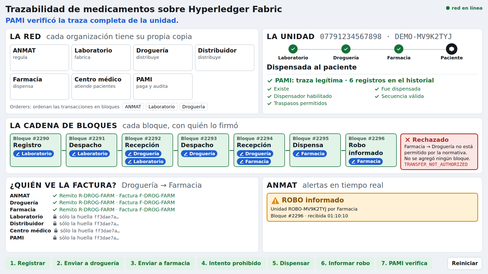

# Demo de la defensa

Guion, boceto de pantalla y acciones de la demo visual del prototipo Fabric
(DEMO-1, #143). La demo dura **3 minutos**, se apoya en una sola pantalla y
muestra **sólo el prototipo Fabric**: la baseline no aparece. Complementa la
sección de demo de DOC-8 (#60), que la preveía como secuencia de comandos sobre
`functional-e2e.sh` y `listen-anmat`.

La idea es seguir **una unidad de medicamento** desde el laboratorio hasta el
paciente. En cada paso la pantalla muestra qué organizaciones firmaron, el
bloque que se agregó y quién tiene la unidad. Todo lo que aparece en pantalla
sale de la red real: respuestas del chaincode, bloques confirmados y datos
privados leídos desde el peer de cada organización. La pantalla no simula nada.

## Corrección al guion de la issue

La issue proponía mostrar el rechazo `TRANSFER_NOT_AUTHORIZED` **junto con** la
alerta a ANMAT. Eso no es lo que hace la red: un rechazo durante la propuesta no
llega al ordenamiento, no tiene bloque y por lo tanto no genera ningún evento que
ANMAT pueda observar ([`anmat-event-listener.md`](anmat-event-listener.md),
«Tres resultados distintos»). Mostrarlo así sería afirmar algo que el prototipo
no hace.

El guion los separa en dos momentos, y la diferencia se vuelve parte del mensaje:

- el **intento prohibido** se rechaza antes de llegar a la cadena: no se agrega
  ningún bloque;
- la **alerta a ANMAT** sale de un evento regulatorio confirmado: la farmacia
  informa el robo de otra unidad y ANMAT lo ve en el momento.

## Guion de 3 minutos

Cada paso tiene un botón en la pantalla y una frase para decir en voz alta. Los
tiempos son acumulados.

| Tiempo | Botón | Qué pasa en la red | Frase |
|---|---|---|---|
| 0:00–0:20 | — | La pantalla ya muestra la red: 7 organizaciones, cada una con su peer, y 3 orderers | «Esta es la red: laboratorio, droguería, distribuidor, farmacia, centro médico, PAMI y ANMAT. Cada uno tiene su propia copia del registro; nadie es dueño de los datos.» |
| 0:20–0:40 | **1. Registrar** | El laboratorio da de alta la unidad. Bloque nuevo | «El laboratorio registra una caja con su número de serie. La operación la firma su peer y queda en un bloque.» |
| 0:40–1:05 | **2. Enviar a droguería** | Despacho del laboratorio y recepción de la droguería. Dos bloques | «La envía a una droguería y la droguería confirma que la recibió. Cada cambio de custodia lo firman las partes. Ahora la custodia es de la droguería.» |
| 1:05–1:25 | **3. Enviar a farmacia** | Despacho de la droguería y recepción de la farmacia. Dos bloques. Se completa el panel de privacidad | «Lo mismo hacia la farmacia. Miren el panel de abajo: el remito y la factura los ven sólo las dos partes y ANMAT. El distribuidor, el centro médico y PAMI ven sólo una huella: saben que existe, pero no qué dice.» |
| 1:25–1:50 | **4. Intento prohibido** | La farmacia intenta devolver la unidad a la droguería. Rechazo `TRANSFER_NOT_AUTHORIZED`. No se agrega bloque | «Ahora la farmacia intenta venderle a una droguería, algo que la normativa no permite. La red lo rechaza antes de registrarlo: la regla está en la red, no en un servidor que alguien podría saltear.» |
| 1:50–2:05 | **5. Dispensar** | La farmacia dispensa la unidad al paciente. Bloque nuevo | «La farmacia la entrega al paciente. La unidad terminó su recorrido.» |
| 2:05–2:30 | **6. Informar robo** | La farmacia informa el robo de otra unidad que tenía en custodia. Bloque nuevo y alerta en el panel de ANMAT | «Si en la farmacia roban una caja, lo informa y ANMAT se entera en el mismo segundo, sin que nadie le mande un mail.» |
| 2:30–3:00 | **7. PAMI verifica** | El financiador ejecuta `VerifyTrace` sobre la unidad dispensada. Se muestra el historial y el veredicto | «Antes de pagar, PAMI verifica la traza: cada paso, quién lo firmó y que todos los traspasos estaban permitidos. Nadie puede borrar ni modificar un paso del historial.» |

Margen: el guion suma 3:00 con frases cortas. Si un paso se demora, el paso 5
puede narrarse sin pausa y el 7 recortarse a la lectura del veredicto.

## La pantalla

La pantalla la sirve `snt-client demo-server` (DEMO-2 y DEMO-3). Así se ve al
terminar el guion, sobre la red local:



## Boceto de la pantalla

Una sola vista, sin navegación, pensada para 1920 × 1080 proyectado y legible en
una notebook de 13". En cualquier resolución ningún texto baja de 18 px y los
títulos de panel tienen 28 px o más. Con menos de 950 px de alto (por ejemplo,
1366 × 768) la letra no se achica: la pantalla pasa a una versión compacta que
oculta el título general y los subtítulos de los paneles, marca la firma sólo
con el color de la tarjeta, agrupa en dos líneas quién ve la factura y muestra
el texto sólo en el botón del paso siguiente, para que la vista completa entre
sin scroll.

```text
┌───────────────────────────────────────────────────────────────────────────────────────┐
│ Trazabilidad de medicamentos sobre Hyperledger Fabric                  ● red en línea │
├───────────────────────────────────────────────┬───────────────────────────────────────┤
│ LA RED                                        │ LA UNIDAD  07791234567898 · DEMO-0001 │
│                                               │                                       │
│   [Laboratorio]   [Droguería]  [Distribuidor] │  ●──────●──────●──────●               │
│                                               │  Labor.  Tránsito Custodia Dispensada │
│   [Farmacia]  [Centro médico]  [PAMI] [ANMAT] │                                       │
│                                               │  Custodio actual: Farmacia            │
│        ○ orderer   ○ orderer   ○ orderer      │  Estado: EN_CUSTODIA                  │
│  (se iluminan las organizaciones que firman)  │                                       │
├───────────────────────────────────────────────┴───────────────────────────────────────┤
│ LA CADENA DE BLOQUES                                                                  │
│  ┌─#1041─────┐  ┌─#1042─────┐  ┌─#1043─────┐  ┌─#1044─────┐  ┌─#1045─────┐           │
│  │ Registrar │─▶│ Despachar │─▶│ Recibir   │─▶│ Despachar │─▶│ Recibir   │─▶ …       │
│  │ firmó Lab │  │ Lab       │  │ Droguería │  │ Droguería │  │ Farmacia  │           │
│  └───────────┘  └───────────┘  └───────────┘  └───────────┘  └───────────┘           │
├────────────────────────────────────────────────┬──────────────────────────────────────┤
│ QUIÉN VE EL REMITO Y LA FACTURA                │ ANMAT                                │
│  Droguería    ✔ R-DEMO-2 · F-DEMO-2            │  ⚠ ROBO informado por Farmacia       │
│  Farmacia     ✔ R-DEMO-2 · F-DEMO-2            │    07791234567898 · DEMO-ROBO-0001   │
│  ANMAT        ✔ R-DEMO-2 · F-DEMO-2            │    bloque #1047 · hace 1 s           │
│  Distribuidor ✖ sólo huella 9f3a…c21e          │                                      │
│  Centro méd.  ✖ sólo huella 9f3a…c21e          │                                      │
│  PAMI         ✖ sólo huella 9f3a…c21e          │                                      │
│  Laboratorio  ✖ sólo huella 9f3a…c21e          │                                      │
├────────────────────────────────────────────────┴──────────────────────────────────────┤
│ [1 Registrar] [2 → Droguería] [3 → Farmacia] [4 Intento prohibido] [5 Dispensar]      │
│ [6 Informar robo] [7 PAMI verifica]                                    [Reiniciar]    │
└───────────────────────────────────────────────────────────────────────────────────────┘
```

Convenciones visuales:

- **Colores con significado único:** verde para lo confirmado, rojo para el
  rechazo, ámbar para la alerta a ANMAT. Cada uno va acompañado de un ícono y un
  texto, nunca sólo el color.
- **Un rechazo nunca dibuja un bloque.** Aparece una tarjeta roja fuera de la
  cadena que dice «rechazado antes de registrarse», para que se vea que la cadena
  no cambió.
- **Las firmas se ven en dos lugares:** las organizaciones se iluminan en el mapa
  durante un segundo y quedan escritas en el bloque.
- **El botón del paso siguiente es el único resaltado**, para que quien maneja la
  pantalla no tenga que pensar el orden.

## Acciones que necesita la pantalla

Lista que consume DEMO-2 (#144). Cada acción se ejecuta con la identidad de la
organización indicada, contra el contrato público
([`api-contract.md`](api-contract.md)), sin cambios en el chaincode ni en la red.

| Paso | Acción | Organización | Funciones del contrato |
|---|---|---|---|
| 1 | Registrar | Laboratorio | `RegisterUnit` |
| 2 | Enviar a droguería | Laboratorio, después droguería | `DispatchTransfer` con `transient` `destinatario` y `commercial`; `ReceiveTransfer` |
| 3 | Enviar a farmacia | Droguería, después farmacia | `DispatchTransfer`; `ReceiveTransfer` |
| 4 | Intento prohibido | Farmacia | `DispatchTransfer` hacia la droguería; se espera `TRANSFER_NOT_AUTHORIZED` |
| 5 | Dispensar | Farmacia | `Dispense` |
| 6 | Informar robo | Farmacia | `ReportStolen` sobre la unidad de robo, preparada en custodia de la farmacia |
| 7 | PAMI verifica | Financiador | `GetUnitHistory`, `VerifyTrace` |
| — | Reiniciar | — | Genera series nuevas para la unidad principal y la de robo, y prepara la segunda en custodia de la farmacia |

Lo que la pantalla observa, sin acción del usuario:

| Panel | Fuente |
|---|---|
| Cadena de bloques y firmas | Bloques completos del canal: número de bloque, función invocada, organizaciones endosantes y código de validación de cada transacción |
| Línea de vida de la unidad | `ReadUnit` y la `MedicationUnitView` que devuelve cada escritura |
| Quién ve el remito y la factura | Para cada una de las 7 organizaciones, el bloque del último despacho pedido **a su propio peer** con sus datos privados. Quien es miembro de la colección recibe el remito y la factura; el resto sólo ve la huella (hash) que está en el bloque |
| ANMAT | Eventos de chaincode recibidos con la identidad de ANMAT, filtrados como en `listen-anmat` (`Quarantine`, `ReportExpired`, `ReportStolen`, `ReportLost`) |

## Requisitos para el día de la defensa

- Funciona sin internet: la interfaz y sus recursos se sirven localmente.
- La red está levantada antes de empezar; el arranque y el reinicio entre ensayos
  son de DEMO-4 (#146).
- Si la demo en vivo falla, se usa el video de respaldo de DEMO-5 (#147).

## Lo que la demo no muestra

- **La caída de un orderer con la red operando**, que DOC-8 incluía en la demo en
  vivo. Se presenta con los resultados de disponibilidad de EVAL-4 y no en vivo,
  porque no entra en 3 minutos sin sacrificar el recorrido de la unidad.
- **La comparación con la baseline**, que se presenta con los resultados de EVAL-7.
